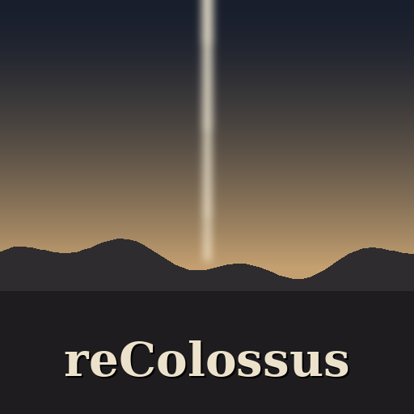

<p align="center">
  
</p>

<h1 align="center">reColossus</h1>

<p align="center">
  <b>Shadow of the Colossus, the PS2 version (USA), statically recompiled into a native app for homebrew-enabled PS5
  consoles.</b>
</p>

> [!IMPORTANT]
> **Bring your own game.** The app is the game's program recompiled for the PS5. It contains none of the game's
> files: the graphics, sound and levels come from your own disc image of the USA PS2 release (SCUS-97472). Please
> don't ask for or share disc images here.

> [!WARNING]
> **Early work.** 0.1 is the first PS5 build: the game's code runs natively, and the PS2's graphics are drawn by
> PS2Recomp's software graphics synthesizer on the CPU, scaled to 1080p. The native renderer (Celosia's, which draws
> the game's models on the GPU) comes next, on Vulkan.

## What it is

The game's MIPS code (the boot ELF and its three code modules) is translated into C++ ahead of time and compiled for
the PS5, as [reKing](https://github.com/coru182/reKing) does for The Return of the King (Xbox) and
[reUndr](https://github.com/bystritskiy/reUndr-ps5) for Need for Speed: Underground. It is built on
[Celosia](https://github.com/HenryKun55/celosia) by HenryKun55, the native port of Shadow of the Colossus to macOS
and the PS Vita, and [PS2Recomp](https://github.com/ran-j/PS2Recomp) by ran-j: their pipeline recompiles the game
and their runtime reimplements the rest of the PS2 (graphics, sound, IOP, memory cards). reColossus adds the PS5
host: the app's start, the first start that unpacks your disc image, and the picture, the DualSense and the sound
through the PS5's own system libraries.

## Requirements

- A PS5 that runs homebrew, with [ShadowMountPlus](https://github.com/drakmor/ShadowMountPlus) (it registers apps
  in `/data/homebrew`) and an FTP server.
- Your own disc image (`.iso`) of Shadow of the Colossus, **USA PS2 release (SCUS-97472)**.
- Room on the console for the game's files, plus the disc image until the first start has unpacked it.

## Install

1. **The app.** Download `PPSA99071-<version>.zip` from [Releases](../../releases/latest), unpack it, and copy the
   `PPSA99071` folder to `/data/homebrew/` on the console. The **reColossus** tile appears on the home screen after
   about 30 seconds.
2. **Your disc.** Copy your disc image to `/data/sotc/` on the console (create the folder), or to a `sotc` folder (or
   the top) of a USB drive.
3. **Play.** Start the tile. The first start unpacks the disc image into `/data/sotc/game/`, then the game starts.
   From then on it starts straight away, and **you can delete the `.iso`**.

Already have the disc's files (`SCUS_974.72`, `KERNEL.XFF`, `MANAGER.XFF`, `GAMECORE.XFF` and the rest)? Copy them
to `/data/sotc/game/` instead. If the game is missing, damaged, or another game or release, a screen says so: press
Cross to close it.

**To update,** copy the new `PPSA99071` folder over the old one. Your saves and the game's files in `/data/sotc/` are
kept.

## Controls

| PS2 | DualSense |
| --- | --- |
| Cross Circle Square Triangle, L1 R1 L2 R2, L3 R3, sticks, d-pad | the same |
| Start | Options |
| Select | touchpad click |
| | **Touchpad twice:** the settings menu |

## Your files

| Where | What |
| --- | --- |
| `/data/homebrew/PPSA99071/` | The app |
| `/data/sotc/game/` | The game's files, unpacked from your disc image at the first start |
| `/data/sotc/memcards/` | Saves (PCSX2-format memory cards) |
| `/data/sotc/env.txt` | Optional: the runtime's settings, one `NAME=value` per line (the app's `README.txt`) |
| `/data/sotc/logs/` | Logs, only while `/data/sotc/logging-on` exists |

## Reporting a problem

Open an [issue](../../issues): say what you were doing, what you expected and what happened. To get a log, create an
empty file `/data/sotc/logging-on` on the console and start the game; attach `/data/sotc/logs/recolossus.log`, then
delete `logging-on` again. **Never attach game files or disc images.**

## For developers

Players don't need any of this: the [Releases](../../releases/latest) have the app ready to copy.

### Building

On Ubuntu 24.04 (x86-64), with Docker for the PS5 toolchain's first build:

```sh
sudo apt-get install ninja-build cmake clang-18 lld-18 llvm-18 llvm-18-dev zlib1g-dev patch zip unzip \
  libarchive-tools pkg-config xvfb xauth libx11-dev libxrandr-dev libxinerama-dev libxcursor-dev libxi-dev \
  libgl1-mesa-dev libgl1-mesa-dri libasound2-dev libwayland-dev libxkbcommon-dev wayland-protocols
./setup.sh /path/to/your/SotC.iso     # the toolchain (once, an hour or more), then the game's code from your disc
./build-ps5.sh                        # build-ps5/PPSA99071-<version>.zip
```

`setup.sh` runs [Celosia's pipeline](https://github.com/HenryKun55/celosia#how-it-works) on Linux: it extracts the
disc, recompiles the boot ELF, runs the game a few times (under `xvfb-run` without a display) to capture each code
module as the game loads it, and records the VU1 microcode the game uploads. `tools/bundle.sh pack` keeps the result
in one file, and `./setup.sh --generated <file>` starts from it later. That file is made from your disc: keep it
private.

### Building on GitHub

The workflow ([`.github/workflows/build.yml`](.github/workflows/build.yml)) builds the PS5 toolchain once and keeps it
in this repository's cache, then reads the disc image from a release of a **private** repository and keeps the
recompiled code in another release of that same private repository, so later runs skip the pipeline.

1. Put your disc image (`.iso`, or a `.zip` holding it) in a release tagged `v0` of a private repository, and set
   `SOC_REPO` in the workflow to it.
2. Make a fine-grained personal access token with **Contents: Read and write** on that private repository only, and
   add it to this repository as the secret `SOC_FILES_TOKEN` (Settings → Secrets and variables → Actions).
3. Run **Actions → Build reColossus → Run workflow**. The first run builds the toolchain and recompiles the game
   (several hours); `toolchain_only` prepares the toolchain alone, `regenerate` recompiles the game again.

The app goes to a draft release `v<version>` (published with `publish`).

### Layout

| Where | What |
| --- | --- |
| `ps5/` | The PS5 host: `main_ps5.cpp` (the app's entry and first start), `iso9660.c` (the disc image), `raylib/` (the raylib subset the runtime uses, on VideoOut, ScePad and SceAudioOut), and reKing's screen, entry and C library pieces |
| `patches/` | Celosia's changes for the PS5: a PS5 target in PS2Recomp's runtime build |
| `setup.sh`, `build-ps5.sh` | The dependencies and the game's code; the app |
| `tools/` | The disc's hashes the app checks, the code bundle, the icon |
| `package/` | The app's `sce_sys`, its `README.txt` and licences |

## Credits

- [Celosia](https://github.com/HenryKun55/celosia) by HenryKun55: the Shadow of the Colossus port this is built on.
- [PS2Recomp](https://github.com/ran-j/PS2Recomp) by ran-j and its contributors: the recompiler and runtime.
- [reUndr-ps5](https://github.com/bystritskiy/reUndr-ps5) by bystritskiy: the PS5 toolchain, link and packaging, and
  the PS5 host pieces reKing took from it.
- [reKing](https://github.com/coru182/reKing): the PS5 app's structure, first start and build.
- Shadow of the Colossus © Sony Interactive Entertainment / Team Ico. This project is not affiliated with or endorsed
  by them.

## Licence

GPL-3.0, as Celosia and PS2Recomp. See [LICENSE](LICENSE) and the app's `licenses/NOTICE.txt`.
